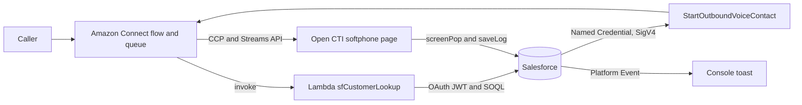

# Salesforce + Amazon Connect CCaaS Integration Lab

A complete, bi-directional Contact Center as a Service (CCaaS) integration lab connecting **Salesforce Service Cloud** and **Amazon Connect**.

This repository contains all infrastructure code, Salesforce metadata, AWS Lambda functions, Open CTI softphone assets, and Amazon Connect contact flow definitions required to build and deploy an enterprise-grade cloud contact center lab.

---

## 1. What It Does

This lab demonstrates how to unite customer relationship management (CRM) with cloud telephony and omnichannel contact routing:

* **Automated IVR & Omnichannel Customer Lookup**:
  * **Voice (Phone Keypad / DTMF)**: Callers are prompted for their customer number (or matched via caller ID / E.164 phone number).
  * **Web Chat**: Incoming chat sessions pass customer parameters directly from the web client.
  * **Serverless Query**: An AWS Lambda function authenticates to Salesforce via the **OAuth 2.0 JWT Bearer Flow** and executes SOQL queries to retrieve the Contact and their most recent open Case.
* **Dynamic IVR Greeting & Case Status Announcement**:
  * The contact flow dynamically speaks (or chats) the customer's first name and latest case status (`"Hello Test. Your latest case status is New."`) before routing them to an agent queue.
* **Embedded Open CTI Softphone & Screen-Pop**:
  * An embedded softphone inside the Salesforce Service Console utility bar hosts the Amazon Connect Contact Control Panel (CCP v2) using the **Amazon Connect Streams API**.
  * When an agent accepts a voice call or chat, the softphone leverages the **Salesforce Open CTI API** to automatically screen-pop the matching Contact and Case records.
* **Automated Call & Interaction Logging**:
  * When a call or chat terminates, the softphone automatically logs a completed `Task` record against the Contact in Salesforce, recording duration, timestamps, and the Amazon Connect contact ID for cross-system auditing.
* **Outbound Click-to-Dial (Telephony API)**:
  * Agents can initiate outbound calls with one click directly from Contact records using a custom Lightning Web Component (`dialButton`).
  * The Apex controller (`ConnectDialer`) triggers Amazon Connect's `StartOutboundVoiceContact` API via Salesforce **Named Credentials** secured with **AWS Signature Version 4 (SigV4)**.
* **Real-Time Case Escalation Alerts**:
  * When a Case is escalated in Salesforce, an Apex trigger fires and publishes a `Case_Escalated__e` **Platform Event**.
  * A console utility LWC (`escalationBanner`) subscribes to the event stream in real time and pops an instant notification toast to console agents.

---

## 2. Architecture



### Detailed Interaction Flows

```
[Inbound Voice / Chat Flow]
Caller ──> Amazon Connect ──> Contact Flow
                                   │
                                   ├─► Invoke AWS Lambda (sfCustomerLookup)
                                   │         │ (OAuth 2.0 JWT Flow)
                                   │         ▼
                                   │     Salesforce REST API (SOQL Contact & Case)
                                   │         │
                                   ◄─────────┘ Returns: sfContactId, firstName, caseStatus
                                   │
                                   ├─► Text-to-Speech: "Hello {firstName}, Case is {caseStatus}"
                                   │
                                   ▼
                            SalesforceLabQueue
                                   │
                                   ▼
             Agent CCP (Streams API in Open CTI Utility Bar)
                                   │
                                   ├─► sforce.opencti.screenPop (Contact Record)
                                   │
                               [Call Ends]
                                   │
                                   └─► sforce.opencti.saveLog (Completed Task)

[Outbound Click-to-Dial Flow]
Agent Clicks 'Call' ──► dialButton LWC ──► ConnectDialer (Apex)
                                                │
                                                ▼ (SigV4 via Named Credential)
                                     AWS Amazon Connect API
                                     (StartOutboundVoiceContact)
                                                │
                                                ▼
                                    LabCallback Contact Flow ──► Connects Agent & Dials Customer

[Real-Time Event Stream]
Case Escalated ──► CaseEscalationTrigger ──► Platform Event (Case_Escalated__e)
                                                        │
                                                        ▼ (empApi Subscription)
                                              escalationBanner LWC (Console Toast)
```

---

## 3. Repository Structure

```
sf-connect-lab/
├── call-center/
│   └── LabCCaaS.xml                 # Open CTI Call Center definition for Salesforce
├── docs/                            # Softphone web app (hosted on GitHub Pages)
│   ├── index.html                   # Softphone container & Open CTI script includes
│   ├── config.js                    # CCP endpoint URL and AWS Region configuration
│   ├── softphone.js                 # Streams API & Open CTI event logic (pop, saveLog, clickToDial)
│   └── connect-streams-min.js       # Amazon Connect Streams library
├── exports/
│   └── connect/                     # Exported Amazon Connect contact flows (JSON)
│       ├── LabInbound.json          # Baseline queue routing flow
│       ├── LabInboundLookup.json    # DTMF keypad + Lambda Salesforce lookup flow
│       ├── LabChatLookup.json       # Web chat lookup flow
│       └── LabCallback.json         # Outbound voice callback flow for click-to-dial
├── lambda/
│   └── sfCustomerLookup/            # Node.js Lambda function for Salesforce SOQL lookups
│       ├── index.mjs                # Lambda handler with JWT Bearer token generation & SOQL
│       └── test-event.json          # Mock Connect event payload for local/cloud testing
├── salesforce/
│   └── force-app/                   # Salesforce DX Source Tree
│       └── main/default/
│           ├── classes/             # ConnectDialer, ConnectDialerTest (SigV4 API caller)
│           ├── customMetadata/      # Connect_Setting.Default (instance ID, flow IDs, numbers)
│           ├── lwc/
│           │   ├── dialButton/      # Click-to-dial action button on Contact records
│           │   └── escalationBanner/# Utility bar real-time toast notification component
│           ├── objects/
│           │   ├── Case_Escalated__e/   # Platform Event definition
│           │   ├── Connect_Setting__mdt/# Custom Metadata schema for CCaaS settings
│           │   └── Contact/             # Custom fields (Customer_Number__c)
│           ├── permissionsets/      # Connect_Outbound, Connect_Lookup_Read
│           └── triggers/            # CaseEscalationTrigger (fires on Case escalation)
│   └── scripts/
│       └── runbook/
│           ├── runbook.md           # Step-by-step rebuild and operational runbook
│           └── Flows.md             # Detailed contact flow configuration guide
├── server.crt                       # Self-signed X.509 certificate for JWT Bearer flow (Lab only)
├── server.key                       # Private RSA key (Lab only)
└── server.key.b64                   # Base64-encoded private key for Lambda environment variables
```

---

## 4. Key Technologies & Security Architecture

| Technology | Role & Integration Details |
| :--- | :--- |
| **Salesforce Service Cloud** | Acts as the CRM core, hosting Contact & Case data, Open CTI softphone, and agent consoles. |
| **Salesforce Open CTI API** | Manages softphone visibility, initiates screen-pops (`screenPop`, `searchAndScreenPop`), registers click-to-dial listeners (`onClickToDial`), and logs activities (`saveLog`). |
| **Amazon Connect (CCP v2)** | Telephony and contact routing engine. Hosted within the Salesforce utility bar via `connect-streams-min.js`. |
| **AWS Lambda (Node.js 22.x)** | Executes contact lookups with sub-second latency. Implements custom token caching for warmed containers. |
| **JWT Bearer Flow (RS256)** | Server-to-server authentication between Lambda and Salesforce without storing user passwords. Utilizes digital signatures with `api` and `refresh_token, offline_access` scopes. |
| **AWS SigV4 & Named Credentials** | Authenticates outbound REST calls from Salesforce Apex directly to Amazon Connect endpoints without hardcoded AWS secrets. |
| **Salesforce Platform Events** | High-throughput event bus publishing escalation notices to console agents via CometD / `lightning/empApi`. |

---

## 5. Quick Start & Operational Guides

For detailed, step-by-step instructions on deploying, configuring, and verifying the lab:

1. **[Rebuild Runbook (`runbook.md`)](salesforce/scripts/runbook/runbook.md)**:
   * End-to-end setup guide covering Salesforce metadata deployment, JWT certificate generation, AWS IAM guardrails, Lambda deployment, and teardown checklists.
2. **[Contact Flows Guide (`Flows.md`)](salesforce/scripts/runbook/Flows.md)**:
   * Block-by-block visual wiring diagrams, attribute mappings, and configuration steps for `LabInbound`, `LabInboundLookup`, `LabChatLookup`, and `LabCallback`.

### Deployment Summary

```bash
# 1. Deploy Salesforce metadata
cd salesforce
sf project deploy start --source-dir force-app --target-org ccaas-dev

# 2. Assign permission sets
sf org assign permset --name Connect_Outbound
sf org assign permset --name Connect_Lookup_Read --on-behalf-of <integration-user>

# 3. Test Lambda locally before deploying to AWS
cd ../lambda/sfCustomerLookup
export SF_LOGIN_URL='https://login.salesforce.com'
export SF_CLIENT_ID='<consumer-key>'
export SF_USERNAME='<integration-username>'
export SF_PRIVATE_KEY_B64="$(cat ../../server.key.b64)"
node --input-type=module -e "import('./index.mjs').then(m => m.handler({ Details: { ContactData: { CustomerEndpoint: { Address: '+61400000000' } }, Parameters: { customerNumber: '1001' } } })).then(console.log)"
```

---

## 6. Smoke Test Scenarios

| Test Case | Channel | Expected Outcome |
| :--- | :--- | :--- |
| **Customer Lookup by Keypad** | Voice | Caller enters `1001#`. IVR announces: *"Hello Test Caller. Your latest case status is New."* Call is enqueued to `SalesforceLabQueue`. |
| **Customer Lookup by Chat** | Chat | Test chat passes `{ "customerNumber": "1001" }`. Bot greets customer with case status. On agent acceptance, softphone pops Contact `Test Caller`. |
| **Outbound Click-to-Dial** | Voice | Agent clicks **Call** button on Contact. Amazon Connect initiates outbound voice contact and connects agent via CCP. |
| **Auto-Logging Task** | Voice / Chat | Call or chat ends. A completed `Task` record appears in the Contact's Activity history containing call duration and Connect contact ID. |
| **Real-Time Escalation** | Console Event | Case is marked `Escalated`. An instant toast banner alerts all active agents in the Service Console. |

---

## 7. Cost & Resource Teardown

> [!WARNING]
> While this lab operates within AWS and Salesforce developer free-tier allowances, claimed phone numbers and active telephone routing incur monthly recurring costs.

When finishing a development or demo session:
1. Release claimed phone numbers in Amazon Connect under **Channels > Phone numbers**.
2. Terminate the Amazon Connect instance and delete the `sfCustomerLookup` Lambda function.
3. Remove temporary AWS IAM user access keys.
4. Review the **AWS Billing > Cost Explorer** console the following day to verify $0 ongoing burn rate.
