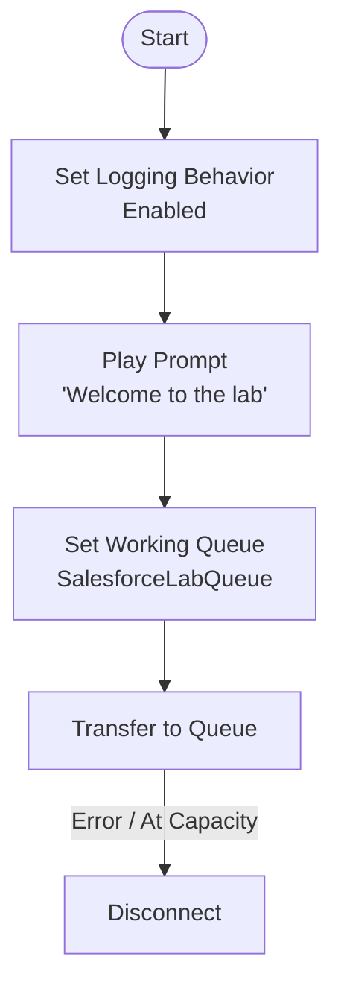
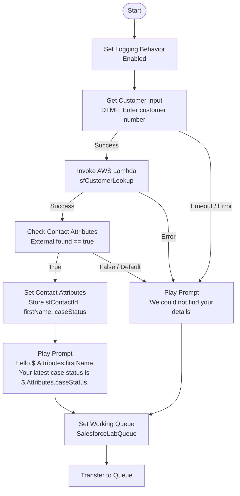
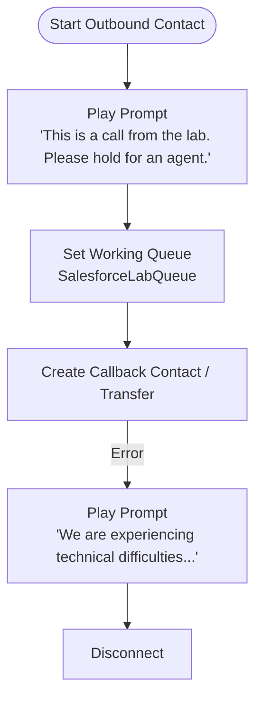

# Amazon Connect Contact Flows Guide

This guide provides end-to-end, block-by-block instructions for creating, configuring, and verifying the four Amazon Connect contact flows used in the Salesforce CCaaS integration lab.

---

## Overview of Flows

| Flow Name | Type | Channel | Description |
| :--- | :--- | :--- | :--- |
| **`LabInbound`** | Inbound Flow | Voice & Chat | Basic baseline flow: greeting, queue assignment (`SalesforceLabQueue`), and agent transfer. |
| **`LabInboundLookup`** | Inbound Flow | Voice (DTMF) | Captures customer number via keypad, queries Salesforce via Lambda, announces Case status, and passes `sfContactId` for screen-pop. |
| **`LabChatLookup`** | Inbound Flow | Chat | Reads `customerNumber` from chat attributes, queries Salesforce via Lambda, sends personalized chat greeting, and pops Contact. |
| **`LabCallback`** | Inbound / Outbound | Voice | Used for Click-to-Dial from Salesforce via `connect:StartOutboundVoiceContact`. |

> [!TIP]
> **Fast Track (Import vs Build from Scratch)**:
> Pre-built JSON flow exports exist in `exports/connect/`. You can import them directly via the Flow Designer (**Routing > Flows > Create flow > Import flow (beta)**). After importing, you **must re-select** the queue (`SalesforceLabQueue`) and Lambda function (`sfCustomerLookup`), as internal resource IDs change between instances.

---

## 1. Flow: `LabInbound` (Baseline Inbound Routing)

### Purpose
Provides a minimal routing pipeline to verify telephony, queue setup, agent CCP connection, and chat messaging before introducing dynamic lookups.

### Flow Architecture


### Block-by-Block Configuration

| Step | Block Name / Type | Configuration Details | Output / Branch Wiring |
| :--- | :--- | :--- | :--- |
| **1** | **Entry Point** | Default starting point. | Wire to **Step 2**. |
| **2** | **Set logging behavior** | Select **Enable**. | Wire to **Step 3**. |
| **3** | **Play prompt** | - **Prompt**: Text-to-speech (Ad hoc)<br>- **Enter text**: `Welcome to the lab` | Wire to **Step 4**. |
| **4** | **Set working queue** | - **Outputs**: By queue<br>- **Queue**: `SalesforceLabQueue` | Wire to **Step 5**. |
| **5** | **Transfer to queue** | No parameters required. | - **Success**: *(Ends flow, caller waits in queue)*<br>- **Error**: Wire to **Step 6**<br>- **At capacity**: Wire to **Step 6** |
| **6** | **Disconnect** | Hangs up call or ends session if transfer fails. | End of flow. |

### Verification & Testing
1. **Chat Test (No phone number required)**:
   - In Connect Admin: **Dashboard > Test chat > Test Settings**.
   - Select contact flow: `LabInbound` and click **Apply**.
   - Open CCP (phone icon at top right) and set agent status to **Available**.
   - Click the chat bubble on the test page; accept the chat in CCP.
2. **Voice Test (If phone number claimed)**:
   - Navigate to **Channels > Phone numbers**.
   - Click your claimed phone number and assign Contact flow: `LabInbound`.
   - Call the number from your mobile; verify prompt plays and call rings in CCP.

---

## 2. Flow: `LabInboundLookup` (Voice DTMF + Salesforce Lookup)

### Purpose
Prompts caller for their customer number via telephone keypad (DTMF), invokes the `sfCustomerLookup` Lambda to query Salesforce, speaks the customer's name and case status, and routes to an agent with `sfContactId` for automatic screen-pop.

### Flow Architecture


### Block-by-Block Configuration

| Step | Block Name / Type | Configuration Details | Output / Branch Wiring |
| :--- | :--- | :--- | :--- |
| **1** | **Set logging behavior** | Select **Enable**. | Wire to **Step 2**. |
| **2** | **Get customer input** | - **Prompt**: Text-to-speech<br>- **Enter text**: `Please enter your customer number followed by the hash key.`<br>- **Input**: DTMF<br>- **Timeout**: `10` seconds<br>- **End input with**: `#` | - **Input entered**: Wire to **Step 3**<br>- **Timeout / Error**: Wire to **Step 8 (Fallback Prompt)** |
| **3** | **Invoke AWS Lambda function** | - **Function**: Select `sfCustomerLookup`<br>- **Timeout**: `8` seconds<br>- **Mode**: Synchronous<br>- **Input Parameters**: Add parameter:<br>  • Destination key: `customerNumber`<br>  • Type: `System`<br>  • Attribute: `Stored customer input` | - **Success**: Wire to **Step 4**<br>- **Error**: Wire to **Step 8 (Fallback Prompt)** |
| **4** | **Check contact attributes** | - **Namespace**: `External`<br>- **Attribute**: `found`<br>- **Conditions**: Add rule:<br>  • Operator: `Equals`<br>  • Value: `true` | - **Condition Matches (`true`)**: Wire to **Step 5**<br>- **No match / Error**: Wire to **Step 8 (Fallback Prompt)** |
| **5** | **Set contact attributes** | Add 4 destination attributes using Type = `External`: <br>1. `sfContactId` ➔ Attribute: `sfContactId`<br>2. `firstName` ➔ Attribute: `firstName`<br>3. `caseNumber` ➔ Attribute: `caseNumber`<br>4. `caseStatus` ➔ Attribute: `caseStatus`<br>*(These map to Salesforce Open CTI softphone pop)* | Wire to **Step 6**. |
| **6** | **Play prompt** (Dynamic Greeting) | - **Prompt**: Text-to-speech<br>- **Enter text**: `Hello $.Attributes.firstName. Your latest case status is $.Attributes.caseStatus.` | Wire to **Step 7**. |
| **7** | **Set working queue** | - **Queue**: `SalesforceLabQueue` | Wire to **Step 9 (Transfer to queue)**. |
| **8** | **Play prompt** (Fallback Message) | - **Prompt**: Text-to-speech<br>- **Enter text**: `We could not find your details.` | Wire to **Step 7 (Set working queue)**. |
| **9** | **Transfer to queue** | Enqueues call to `SalesforceLabQueue`. | - **Error / At capacity**: Wire to Disconnect block. |

> [!IMPORTANT]
> **Graceful Degradation Pattern**:
> Notice that the fallback prompt (`Step 8`) routes back to `SalesforceLabQueue`. The caller must always reach an agent, even if the customer enters an invalid number or Salesforce/Lambda is unavailable.

---

## 3. Flow: `LabChatLookup` (Chat Channel Lookup)

### Purpose
Adapts the lookup functionality for web chat. Because web chat contacts cannot press keypad digits, the customer identifier is passed directly via chat attributes, and messages are sent as chat text.

### Key Differences from `LabInboundLookup`
1. **Omit Keypad Block**: Remove the **Get customer input** block.
2. **Lambda Parameter Source**: Change the Lambda input parameter `customerNumber` from `System: Stored customer input` to **`User defined: customerNumber`**.
3. **Chat Messages**: The **Play prompt** blocks automatically render as text messages in the chat window.

### Block-by-Block Configuration

| Step | Block Name / Type | Configuration Details | Output / Branch Wiring |
| :--- | :--- | :--- | :--- |
| **1** | **Set logging behavior** | Select **Enable**. | Wire to **Step 2**. |
| **2** | **Invoke AWS Lambda function** | - **Function**: `sfCustomerLookup`<br>- **Timeout**: `8` seconds<br>- **Input Parameters**:<br>  • Destination key: `customerNumber`<br>  • Type: `User defined`<br>  • Attribute: `customerNumber` | - **Success**: Wire to **Step 3**<br>- **Error**: Wire to **Step 7 (Fallback)** |
| **3** | **Check contact attributes** | - **Namespace**: `External`<br>- **Attribute**: `found`<br>- **Operator**: `Equals` `true` | - **True**: Wire to **Step 4**<br>- **False / Default**: Wire to **Step 7 (Fallback)** |
| **4** | **Set contact attributes** | Copy external values to contact attributes:<br>- `sfContactId` ➔ `External: sfContactId`<br>- `firstName` ➔ `External: firstName`<br>- `caseStatus` ➔ `External: caseStatus`<br>- `caseNumber` ➔ `External: caseNumber` | Wire to **Step 5**. |
| **5** | **Play prompt** (Chat Greeting) | - **Text-to-speech**: `Hello $.Attributes.firstName. Your latest case status is $.Attributes.caseStatus.` | Wire to **Step 6**. |
| **6** | **Set working queue** | - **Queue**: `SalesforceLabQueue` | Wire to **Step 8 (Transfer)**. |
| **7** | **Play prompt** (Fallback Chat) | - **Text-to-speech**: `We could not find your details.` | Wire to **Step 6 (Set working queue)**. |
| **8** | **Transfer to queue** | Transits chat to agent queue. | - **Error / At capacity**: Disconnect. |

### Verification & Testing
1. In Connect Admin: **Dashboard > Test chat > Test Settings**.
2. Select contact flow: `LabChatLookup`.
3. Under **Contact Attributes**, pass the customer number:
   ```json
   {
     "customerNumber": "1001"
   }
   ```
4. Click **Apply**, then open the chat bubble.
5. **Expected Result**:
   - The bot replies in chat: `"Hello Test. Your latest case status is New."`
   - The CCP rings and displays the incoming chat.
   - When accepted, Salesforce screen-pops the Contact record (`Test Caller`) and linked Case.

---

## 4. Flow: `LabCallback` (Outbound Click-to-Dial)

### Purpose
Used when an agent clicks the **Call** button on a Contact in Salesforce. The Salesforce Apex class `ConnectDialer` initiates an outbound voice contact using Amazon Connect's `StartOutboundVoiceContact` API, directing the call through this flow.

### Flow Architecture


### Block-by-Block Configuration

| Step | Block Name / Type | Configuration Details | Output / Branch Wiring |
| :--- | :--- | :--- | :--- |
| **1** | **Play prompt** | - **Prompt**: Text-to-speech<br>- **Enter text**: `This is a call from the lab. Please hold for an agent.` | Wire to **Step 2**. |
| **2** | **Set working queue** | - **Queue**: `SalesforceLabQueue` | Wire to **Step 3**. |
| **3** | **Create callback contact** *(or Transfer to queue)* | - **Initial delay**: `0` (or as configured)<br>- **Mode**: Agent first / Standard callback | - **Success**: End of flow<br>- **Error**: Wire to **Step 4** |
| **4** | **Play prompt** (Error) | - **Text-to-speech**: `We are experiencing technical difficulties, please call back later.` | Wire to **Step 5**. |
| **5** | **Disconnect** | Hangs up. | End of flow. |

---

## Flow Attributes Reference & Syntax

### Interpolation Syntax in Prompts
Amazon Connect uses JSONPath-style syntax for dynamic variable interpolation:

| Expression | Source | Example |
| :--- | :--- | :--- |
| `$.Attributes.firstName` | Contact Attribute stored in flow | Resolves to customer's first name (e.g., `Test`) |
| `$.Attributes.caseStatus` | Contact Attribute stored in flow | Resolves to Case status (e.g., `New`, `Working`) |
| `$.External.found` | Returned directly by Lambda | Returns string `"true"` or `"false"` |
| `$.External.sfContactId` | Returned directly by Lambda | 18-character Salesforce Contact ID |

### Attributes Required for Salesforce Screen-Pop
For the Open CTI Softphone (`docs/index.html` via `opencti_min.js`) to screen-pop records:
- **`sfContactId`**: Must contain the Salesforce 18-character Contact ID (e.g., `003...`).
- When Amazon Connect delivers the contact to CCP, `opencti_min.js` reads `contact.getAttributes().sfContactId` and executes `sforce.opencti.screenPop({ type: sforce.opencti.SCREENPOP_TYPE.SOBJECT, params: { recordId: sfContactId } })`.
